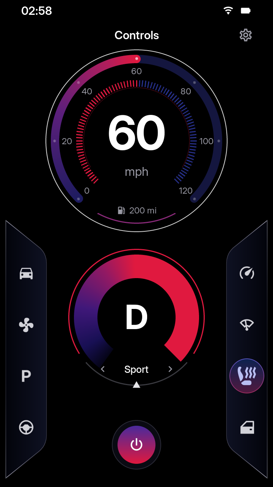
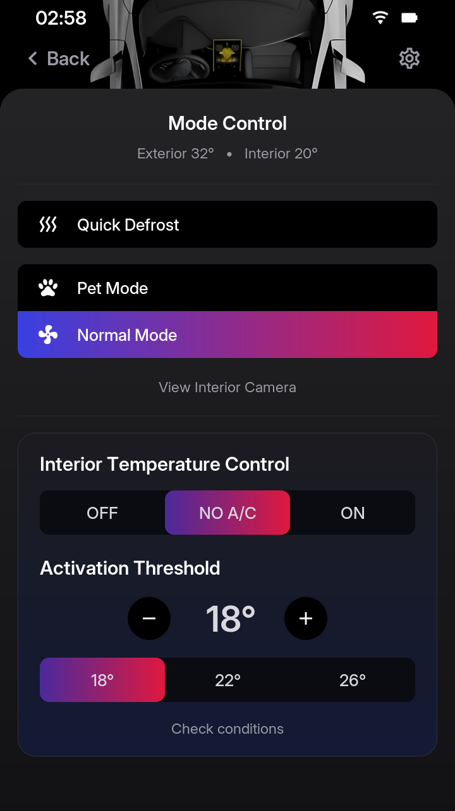
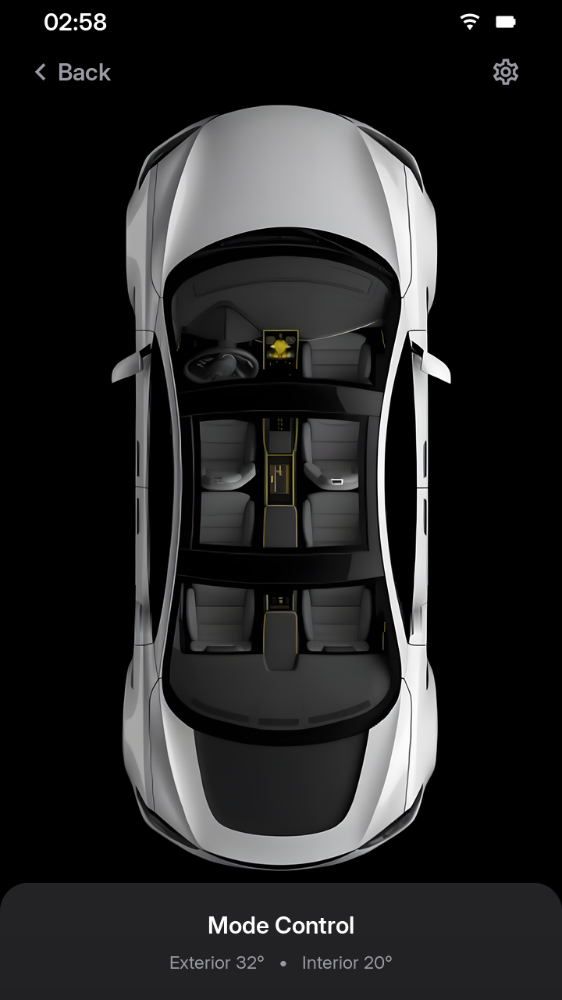
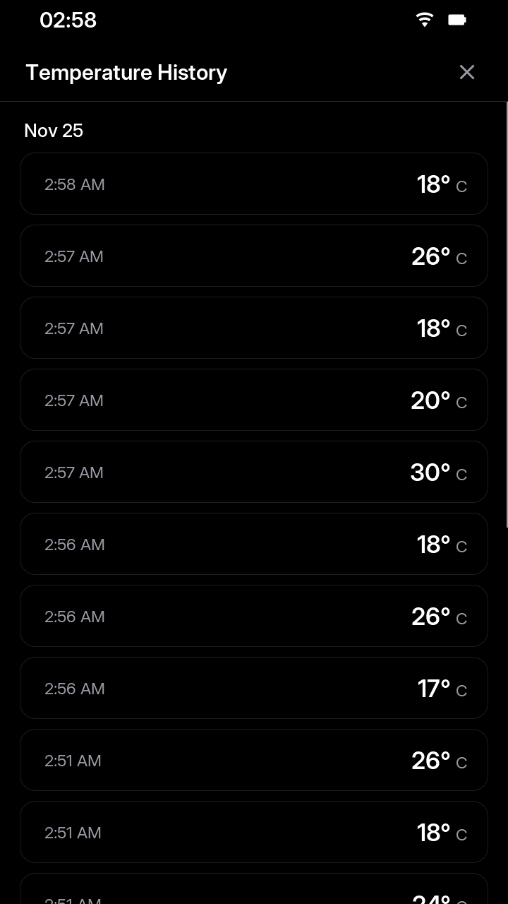

# Car Dashboard UI

A dark, animated car climate-control UI for a 720x1280 portrait touch display, built with
**LVGL Pro** and LVGL 9.6: a driving Controls screen with speed and gear dials, an A/C screen
where a Mode Control sheet is dragged over a top-down view of the car, and a Temperature History
of the activation threshold.

<table>
  <tr>
    <td></td>
    <td></td>
    <td></td>
    <td></td>
  </tr>
  <tr>
    <td align="center">Controls</td>
    <td align="center">A/C: Mode Control</td>
    <td align="center">A/C: sheet closed</td>
    <td align="center">Temperature History</td>
  </tr>
</table>

The screenshots come from the preview runtime, via the flow test in `tests/test_flow.xml`.

## Credits

The design and the animations are recreated from a
[YouTube Short by DesignCode](https://youtube.com/shorts/Y4Yh--T_eF8) ([@DesignCodeTeam](https://www.youtube.com/@DesignCodeTeam)),
where the original UI was built in React Native. All credit for the design goes to them.

## What's inside

- `project.xml`: Display targets and the LVGL version to build against
- `globals.xml`: The place for project-wide constants, colors, fonts, styles, and subjects
- `screens/`, `components/`, `widgets/`: The UI files, one per XML file. Each folder has a
  README describing what belongs in it
- `custom/`: Hand-written C for the logic XML cannot express (sheet dragging, history, intro)
- `images/`, `fonts/`: Assets, converted and compiled in by the Editor
- `tests/`: An XML test that walks the whole flow
- `docs/screenshots/`: The images above
- `sim/`: The built-in simulator, see [`sim/README.md`](sim/README.md)

## Building

**Ctrl+B** or the hammer icon exports the C code and compiles it, **F5** runs it in the simulator.

## Learn more

Check out the docs at **<https://lvgl.io/docs/pro>**. These are the key pages to learn XML:

- [XML overview](https://lvgl.io/docs/pro/syntax/overview): Basics of the syntax
- [Components](https://lvgl.io/docs/pro/syntax/components), [Widgets](https://lvgl.io/docs/pro/syntax/widgets) and [Screens](https://lvgl.io/docs/pro/syntax/screens): The basic building blocks of a UI
- [Built-in widgets](https://lvgl.io/docs/pro/built_in_widgets): the XML API of `lv_obj`, `lv_button`, `lv_slider`, etc, and all the style properties
- [Styles](https://lvgl.io/docs/pro/syntax/styles) and [Constants](https://lvgl.io/docs/pro/syntax/constants): To make UIs more maintainable
- [Data binding](https://lvgl.io/docs/pro/syntax/data-binding): Connect the UI to your application data
- [Testing](https://lvgl.io/docs/pro/syntax/testing) and the [CLI](https://lvgl.io/docs/pro/cli): To validate your work automatically
- [AI integration](https://lvgl.io/docs/pro/ai): For agents to learn how to work effectively with LVGL Pro and the XML

The [**lvgl/lvgl_pro**](https://github.com/lvgl/lvgl_pro) repository is also worth checking. It contains examples, tutorials, and
[`lvgl_widgets_xml/`](https://github.com/lvgl/lvgl_pro/tree/master/lvgl_widgets_xml) with the XML schema of LVGL's built-in widgets.
Both humans and agents can check exactly which properties, enums, styles, and other elements are available. See
[lv_slider.xml](https://github.com/lvgl/lvgl_pro/blob/master/lvgl_widgets_xml/v9.6.0/lv_slider.xml) as an example.
AI agents can clone the whole repo or get only one file.
